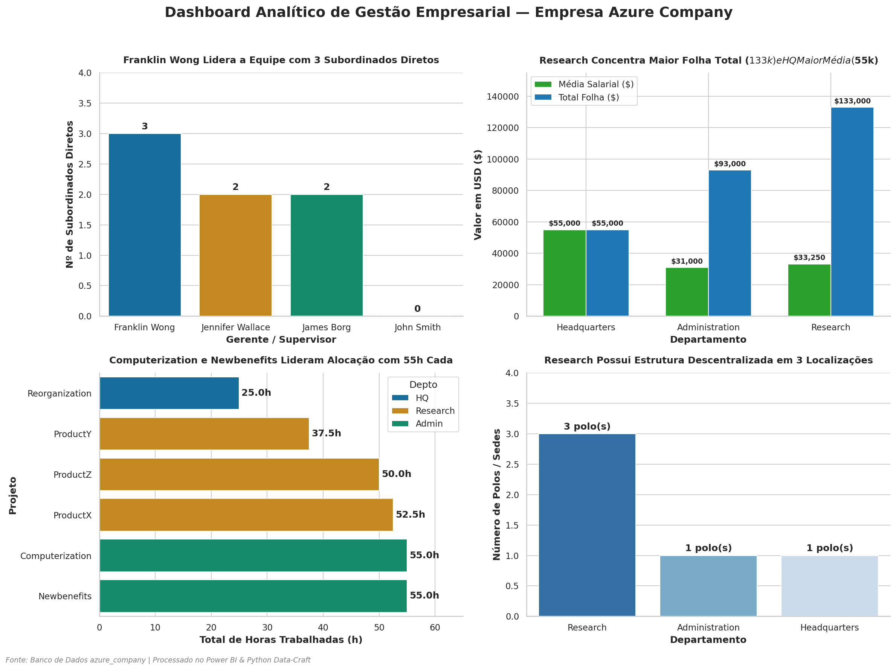
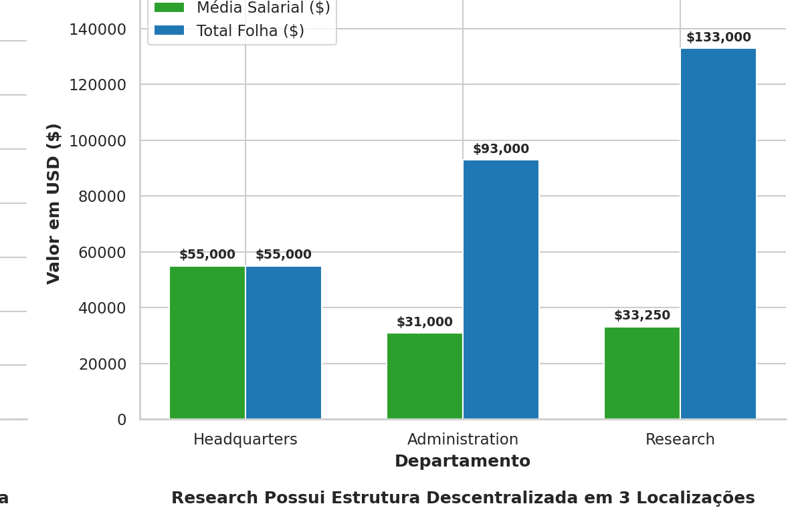
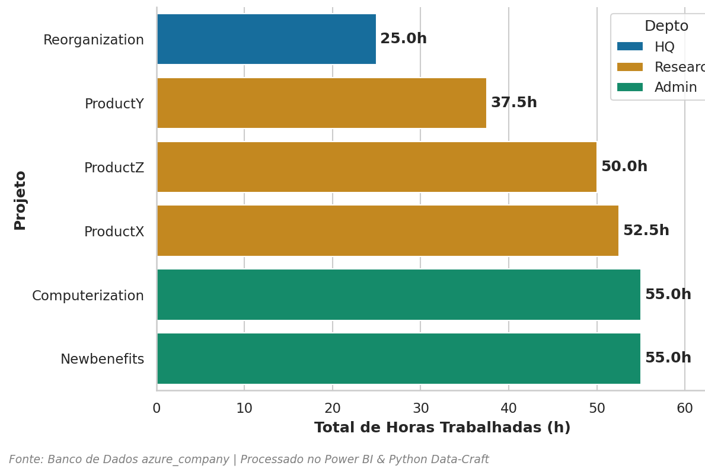
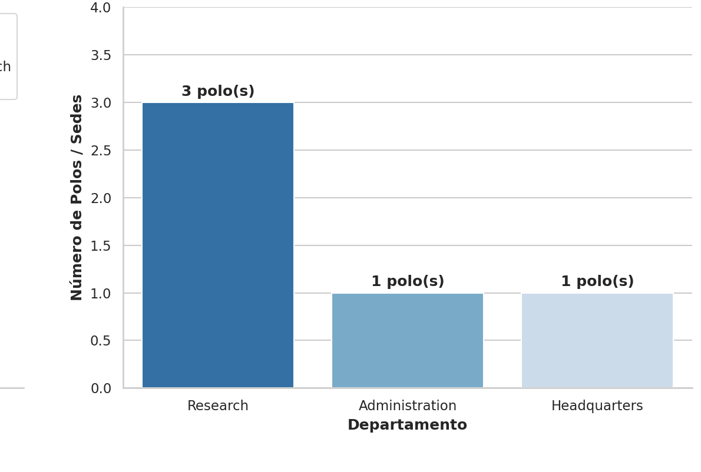

# DIO---Dashboard-Analitico-de-Gestao-Empresarial

## Visao Geral do Projeto

## Painel Analitico Final e Diagrama do Banco

### Dashboard de Gestao Empresarial


## Lista de Verificacao de Diretrizes do Projeto (100% Concluido)

- [x] **Configuracao e Instanciacao Azure MySQL**: Criacao do banco azure_company, regras de firewall e conexao via DBeaver/Workbench.
- [x] **Verificacao de Cabecalhos e Tipos de Dados**: Tipos numericos de alta precisao para salarios (Double/Decimal), datas (Date) e horas.
- [x] **Diagnostico de Nulos (Super_ssn)**: Identificacao e justificativa tecnica da manutencao do nulo do CEO **James Borg**.
- [x] **Verificacao de Gerentes de Departamentos**: Confirmacao de que todos os 3 departamentos (*Research*, *Administration*, *Headquarters*) possuem gerentes ativos atribuídos.
- [x] **Tratamento de Carga Horaria (works_on)**: Identificacao e analise do registro com 0.0 horas (James Borg no projeto *Reorganization*).
- [x] **Desmembramento de Colunas Complexas**: Separacao do campo Address em Numero_Logradouro, Rua, Cidade e Estado.
- [x] **Concatenacao de Nomes de Colaboradores**: Juncao de Fname, Minit e Lname na coluna Nome_Completo.
- [x] **Auto-Juncao de Colaboradores e Gerentes (Self-Join)**: Implementacao de VIEW no DBeaver (vw_employee_gerente) e mescla no Power Query.
- [x] **Juncao Departamento-Localizacao**: Combinacao de departament e dept_locations gerando pares unicos de polo regional.
- [x] **Justificativa Tecnica (Mesclar vs. Atribuir)**: Explicacao detalhada da diferenca entre Merge (horizontal) e Append (vertical).
- [x] **Agrupamento por Gerente**: Calculo exato da quantidade de subordinados diretos por lideranca.
- [x] **Otimizacao do Modelo**: Remocao de chaves estrangeiras redundantes pos-mescla para melhor desempenho da engine VertiPaq.
- [x] **Construcao dos 4 Visuais do Dashboard**: Graficos de Lideranca, Financeiro, Horas por Projeto e Polos Regionais configurados e formatados em tema escuro.

## Detalhamento do Processo

### 1. Ajuste de Tipos de Dados e Cabecalhos
- Salary: Convertido para Decimal/Double de precisao fixa no Power Query.
- Hours: Ajustado para decimal numerico (Double).
- Datas (Bdate, Mgr_start_date): Ajustadas estritamente para Date.

### 2. Tratamento de Valores Nulos e Estrutura Organizacional
- **Analise do Super_ssn = NULL**: O unico colaborador com supervisor nulo e **James Borg** (SSN: 888665555), CEO da empresa. Como nao responde a nenhum superior na hierarquia, o valor nulo e anatomicamente e administrativamente correto.
- **Gerentes de Departamento**:
  - Headquarters (Dnumber: 1) -> James Borg
  - Administration (Dnumber: 4) -> Jennifer Wallace
  - Research (Dnumber: 5) -> Franklin Wong

### 3. Divisao do Campo de Endereco (Address)
A coluna Address (ex: 731-Fondren-Houston-TX) foi desmembrada em 4 atributos: Numero_Logradouro, Rua, Cidade e Estado.

## Questao Conceitual: Mesclar (Merge) vs. Atribuir (Append)

### Por que utilizar MESCLAR (Merge) e NAO ATRIBUIR (Append) para a combinacao Departamento-Localizacao?

> **Definicao Tecnica:**
> - **Mesclar (Merge / Join)**: Combina tabelas na horizontal adicionando novas colunas com base em uma chave relacional compartilhada.
> - **Atribuir (Append / Union)**: Empilha tabelas na vertical adicionando novas linhas de tabelas com a mesma estrutura de colunas.

### Justificativa Aplicada:
1. **Associacao Estrutural de Atributos**: Ao associar departamentos (departament) com suas sedes fisicas (dept_locations), precisamos expandir a descricao do departamento adicionando a cidade onde ele atua. Isso requer a operacao horizontal (Merge) conectada pela chave Dnumber.
2. **Modelo Estrela (Star Schema)**: O resultado dessa mescla e uma tabela dimensional consolidada contendo pares unicos de Departamento-Localizacao (ex: Research-Bellaire, Research-Sugarland, Research-Houston, Administration-Stafford, Headquarters-Houston).
3. **Inviabilidade do Append**: Se utilizassemos Append, o Power BI apenas adicionaria as linhas da tabela de localizacoes abaixo das linhas de departamentos, criando uma tabela incoerente com colunas desalinhadas e valores nulos intercalados.

## Detalhamento dos Visuais do Dashboard

### 1. Grafico de Lideranca e Subordinacao

- **Tipo de Visual**: Grafico de Colunas Agrupadas.
- **Eixo X**: Nome_Gerente.
- **Eixo Y**: Medida DAX Qtd_Subordinados = COUNTROWS("vw_employee_gerente").
- **Filtro Aplicado**: Ocultada a barra Sem Gerente (CEO) para focar nas equipes lideradas.
- **Resultados**: Franklin Wong lidera com 3 subordinados diretos; Jennifer Wallace e James Borg possuem 2 subordinados diretos cada.

### 2. Grafico Financeiro e Salarial por Departamento

- **Tipo de Visual**: Grafico de Colunas Agrupadas.
- **Eixo X**: Dname (Nome do Departamento).
- **Eixo Y**: Soma de Salario ($133k em Research, $93k em Admin, $55k em HQ) e Media salarial ($33.25k em Research, $31k em Admin, $55k em HQ).
- **Legenda**: Vazia.

### 3. Grafico de Alocacao de Carga Horaria em Projetos

- **Tipo de Visual**: Grafico de Barras Agrupadas (Barras Horizontais).
- **Eixo Y**: Pname (Nome do Projeto).
- **Eixo X**: Soma de Hours (Total de Horas Trabalhadas).
- **Legenda**: Dname (Departamento responsavel).
- **Classificacao**: Ordenacao crescente por horas.

### 4. Grafico de Descentralizacao e Polos Regionais

- **Tipo de Visual**: Grafico de Colunas Agrupadas.
- **Eixo X**: Dname.
- **Eixo Y**: Contagem (Distinta) de Dlocation.
- **Resultados**: Research possui estrutura descentralizada com 3 polos, enquanto Admin e HQ operam em 1 polo cada.

## Solucao de Problemas Tecnicos Enfrentados

1. **Erro ComplexHighlightsNotAllowed**: Ocorrido ao clicar em elementos visuais que tentavam aplicar destaque cruzado em medidas implicitas sem tabela ligada. Solucao: Criacao de medida explicita em DAX COUNTROWS e alteracao das interacoes para modo de Filtro no Power BI.
2. **Barras Fragmentadas por Funcionario**: Campo desnecessario inserido na caixa Legenda do grafico de lideranca. Solucao: Remocao do campo da Legenda.
3. **Formatacao para Tema Escuro**: Desativacao da opcao Borda do Visual e configuracao de Fundo Transparente (100%) nas opçoes de Efeitos.

## Estrutura do Repositorio

```text
.
├── README.md                           <- Documentacao tecnica do repositorio
├── dashboard_company_analytics.png     <- Print completo do Dashboard Analitico
├── diagrama_relacional.png             <- Diagrama do modelo de dados relacional
├── grafico_1_lideranca.png             <- Print do Grafico de Lideranca
├── grafico_2_financeiro.png            <- Print do Grafico Financeiro/Salarial
├── grafico_3_projetos.png              <- Print do Grafico de Horas em Projetos
└── grafico_4_polos.png                 <- Print do Grafico de Polos Regionais
```

